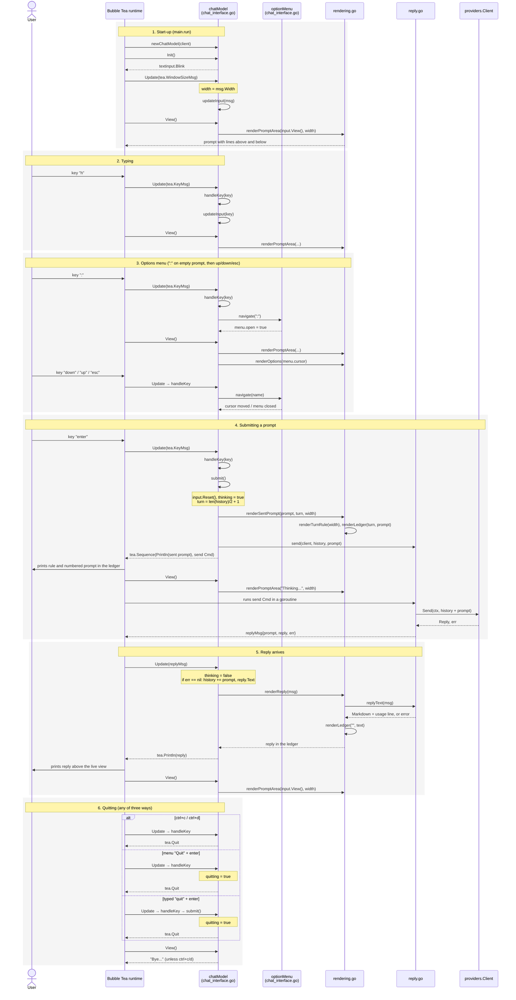

# Chat interface sequence

How `chatModel` in `chat_interface.go` handles a session, from start-up to quitting. Every method in `chat_interface.go` appears below, along with the rendering functions in `rendering.go` and the reply functions in `reply.go` that it calls.

## Where each function appears

| Function | File:line | Called by | Phase |
|---|---|---|---|
| `newChatModel` | `chat_interface.go:23` | `run` in `main.go` | 1 |
| `Init` | `chat_interface.go:31` | runtime, once | 1 |
| `Update` | `chat_interface.go:37` | runtime, for every message | 1–6 |
| `handleKey` | `chat_interface.go:55` | `Update` on `tea.KeyMsg` | 2, 3, 4, 6 |
| `submit` | `chat_interface.go:72` | `handleKey` on enter | 4, 6 |
| `updateInput` | `chat_interface.go:86` | `Update` (other messages) and `handleKey` (typing) | 1, 2 |
| `View` | `chat_interface.go:93` | runtime, after every `Update` | 1–6 |
| `optionMenu.navigate` | `chat_interface.go:117` | `handleKey` while the menu is open or on ":" | 3 |
| `renderSentPrompt` | `rendering.go:12` | `submit` | 4 |
| `renderReply` | `rendering.go:19` | `Update` on `replyMsg` | 5 |
| `renderPromptArea` | `rendering.go:26` | `View` | 1–5 |
| `renderOptions` | `rendering.go:32` | `View` while the menu is open | 3 |
| `renderLedger` | `rendering.go:49` | `renderSentPrompt`, `renderReply` | 4, 5 |
| `renderTurnRule` | `rendering.go:60` | `renderSentPrompt` | 4 |
| `send` | `reply.go:24` | `submit` | 4 |
| `replyText` | `reply.go:35` | `renderReply` | 5 |

## Notes

- Ctrl+C and Ctrl+D do not set `quitting`, so the last `View` shows the prompt rather than "Bye...". The other two quit paths do set it.
- The menu's enter only closes the list. The `TODO` in `navigate` (`chat_interface.go:126`) is still open, so Provider, Model and History do nothing yet; only the Quit case in `handleKey` acts on a selection.
- The turn number comes from the saved history, which only grows on a successful reply, so a failed send leaves the next prompt with the same number.
- Line numbers reflect the code at the time of writing and will drift as the files change.
